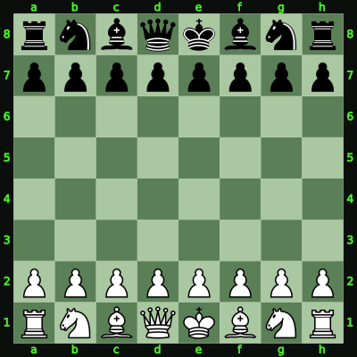

  

<table>
<tr>
<td width="42%" valign="top">

</td>
<td width="58%" valign="top">

</td>
</tr>
<tr>
<td valign="top"><code>./heircut</code> 《宫廷理发师》：拿剪刀给客人剪头发，剪下来的词还能改写剧情。<a href="https://store.steampowered.com/app/4268650/">Steam</a> · <a href="https://yufenghuang.tech/series/heircut-%E5%BC%80%E5%8F%91%E6%89%8B%E8%AE%B0/">开发手记</a></td>
<td valign="top"><code>beesay</code> 小蜜蜂每隔几秒念一句我喜欢的话。</td>
</tr>
</table>

### `$ tomo --status`

<picture>
  <source media="(prefers-color-scheme: dark)" srcset="https://raw.githubusercontent.com/EvanWonghere/EvanWonghere/main/dist/pet.svg">
  <source media="(prefers-color-scheme: light)" srcset="https://raw.githubusercontent.com/EvanWonghere/EvanWonghere/main/dist/pet-light.svg">
  
</picture>

这只像素猫每 6 小时看一眼我的提交记录：在写代码它就开心，好几天没提交它就守着空饭碗，凌晨它会睡觉。

### `$ chess --everyone`

一盘所有人一起下的国际象棋，现在轮到 **<!-- BEGIN TURN -->白方<!-- END TURN -->**。在右边找到想走的棋子，点它要去的格子，GitHub 会打开一个写好标题的 issue，直接提交就行，一分钟左右棋盘会更新。同一个人不能连走两步。

<table>
<tr>
<td valign="top">
<!-- BEGIN CHESS BOARD -->

<!-- END CHESS BOARD -->
</td>
<td valign="top">
<!-- BEGIN MOVES LIST -->

| 从 | 到（点一下就行） |
| :-: | :--------------- |
| **A2** | [A3](https://github.com/EvanWonghere/EvanWonghere/issues/new?body=%E8%AF%B7%E4%B8%8D%E8%A6%81%E4%BF%AE%E6%94%B9%E6%A0%87%E9%A2%98%EF%BC%8C%E7%9B%B4%E6%8E%A5%E7%82%B9%E7%BB%BF%E8%89%B2%E7%9A%84+Create+%E6%8C%89%E9%92%AE%E6%8F%90%E4%BA%A4%E5%B0%B1%E8%A1%8C%EF%BC%8C%E5%88%AB%E7%9A%84%E4%BB%80%E4%B9%88%E9%83%BD%E4%B8%8D%E7%94%A8%E5%81%9A+%3AD&title=Chess%3A+Move+A2+to+A3), [A4](https://github.com/EvanWonghere/EvanWonghere/issues/new?body=%E8%AF%B7%E4%B8%8D%E8%A6%81%E4%BF%AE%E6%94%B9%E6%A0%87%E9%A2%98%EF%BC%8C%E7%9B%B4%E6%8E%A5%E7%82%B9%E7%BB%BF%E8%89%B2%E7%9A%84+Create+%E6%8C%89%E9%92%AE%E6%8F%90%E4%BA%A4%E5%B0%B1%E8%A1%8C%EF%BC%8C%E5%88%AB%E7%9A%84%E4%BB%80%E4%B9%88%E9%83%BD%E4%B8%8D%E7%94%A8%E5%81%9A+%3AD&title=Chess%3A+Move+A2+to+A4) |
| **B1** | [A3](https://github.com/EvanWonghere/EvanWonghere/issues/new?body=%E8%AF%B7%E4%B8%8D%E8%A6%81%E4%BF%AE%E6%94%B9%E6%A0%87%E9%A2%98%EF%BC%8C%E7%9B%B4%E6%8E%A5%E7%82%B9%E7%BB%BF%E8%89%B2%E7%9A%84+Create+%E6%8C%89%E9%92%AE%E6%8F%90%E4%BA%A4%E5%B0%B1%E8%A1%8C%EF%BC%8C%E5%88%AB%E7%9A%84%E4%BB%80%E4%B9%88%E9%83%BD%E4%B8%8D%E7%94%A8%E5%81%9A+%3AD&title=Chess%3A+Move+B1+to+A3), [C3](https://github.com/EvanWonghere/EvanWonghere/issues/new?body=%E8%AF%B7%E4%B8%8D%E8%A6%81%E4%BF%AE%E6%94%B9%E6%A0%87%E9%A2%98%EF%BC%8C%E7%9B%B4%E6%8E%A5%E7%82%B9%E7%BB%BF%E8%89%B2%E7%9A%84+Create+%E6%8C%89%E9%92%AE%E6%8F%90%E4%BA%A4%E5%B0%B1%E8%A1%8C%EF%BC%8C%E5%88%AB%E7%9A%84%E4%BB%80%E4%B9%88%E9%83%BD%E4%B8%8D%E7%94%A8%E5%81%9A+%3AD&title=Chess%3A+Move+B1+to+C3) |
| **B2** | [B3](https://github.com/EvanWonghere/EvanWonghere/issues/new?body=%E8%AF%B7%E4%B8%8D%E8%A6%81%E4%BF%AE%E6%94%B9%E6%A0%87%E9%A2%98%EF%BC%8C%E7%9B%B4%E6%8E%A5%E7%82%B9%E7%BB%BF%E8%89%B2%E7%9A%84+Create+%E6%8C%89%E9%92%AE%E6%8F%90%E4%BA%A4%E5%B0%B1%E8%A1%8C%EF%BC%8C%E5%88%AB%E7%9A%84%E4%BB%80%E4%B9%88%E9%83%BD%E4%B8%8D%E7%94%A8%E5%81%9A+%3AD&title=Chess%3A+Move+B2+to+B3), [B4](https://github.com/EvanWonghere/EvanWonghere/issues/new?body=%E8%AF%B7%E4%B8%8D%E8%A6%81%E4%BF%AE%E6%94%B9%E6%A0%87%E9%A2%98%EF%BC%8C%E7%9B%B4%E6%8E%A5%E7%82%B9%E7%BB%BF%E8%89%B2%E7%9A%84+Create+%E6%8C%89%E9%92%AE%E6%8F%90%E4%BA%A4%E5%B0%B1%E8%A1%8C%EF%BC%8C%E5%88%AB%E7%9A%84%E4%BB%80%E4%B9%88%E9%83%BD%E4%B8%8D%E7%94%A8%E5%81%9A+%3AD&title=Chess%3A+Move+B2+to+B4) |
| **C2** | [C3](https://github.com/EvanWonghere/EvanWonghere/issues/new?body=%E8%AF%B7%E4%B8%8D%E8%A6%81%E4%BF%AE%E6%94%B9%E6%A0%87%E9%A2%98%EF%BC%8C%E7%9B%B4%E6%8E%A5%E7%82%B9%E7%BB%BF%E8%89%B2%E7%9A%84+Create+%E6%8C%89%E9%92%AE%E6%8F%90%E4%BA%A4%E5%B0%B1%E8%A1%8C%EF%BC%8C%E5%88%AB%E7%9A%84%E4%BB%80%E4%B9%88%E9%83%BD%E4%B8%8D%E7%94%A8%E5%81%9A+%3AD&title=Chess%3A+Move+C2+to+C3), [C4](https://github.com/EvanWonghere/EvanWonghere/issues/new?body=%E8%AF%B7%E4%B8%8D%E8%A6%81%E4%BF%AE%E6%94%B9%E6%A0%87%E9%A2%98%EF%BC%8C%E7%9B%B4%E6%8E%A5%E7%82%B9%E7%BB%BF%E8%89%B2%E7%9A%84+Create+%E6%8C%89%E9%92%AE%E6%8F%90%E4%BA%A4%E5%B0%B1%E8%A1%8C%EF%BC%8C%E5%88%AB%E7%9A%84%E4%BB%80%E4%B9%88%E9%83%BD%E4%B8%8D%E7%94%A8%E5%81%9A+%3AD&title=Chess%3A+Move+C2+to+C4) |
| **D2** | [D3](https://github.com/EvanWonghere/EvanWonghere/issues/new?body=%E8%AF%B7%E4%B8%8D%E8%A6%81%E4%BF%AE%E6%94%B9%E6%A0%87%E9%A2%98%EF%BC%8C%E7%9B%B4%E6%8E%A5%E7%82%B9%E7%BB%BF%E8%89%B2%E7%9A%84+Create+%E6%8C%89%E9%92%AE%E6%8F%90%E4%BA%A4%E5%B0%B1%E8%A1%8C%EF%BC%8C%E5%88%AB%E7%9A%84%E4%BB%80%E4%B9%88%E9%83%BD%E4%B8%8D%E7%94%A8%E5%81%9A+%3AD&title=Chess%3A+Move+D2+to+D3), [D4](https://github.com/EvanWonghere/EvanWonghere/issues/new?body=%E8%AF%B7%E4%B8%8D%E8%A6%81%E4%BF%AE%E6%94%B9%E6%A0%87%E9%A2%98%EF%BC%8C%E7%9B%B4%E6%8E%A5%E7%82%B9%E7%BB%BF%E8%89%B2%E7%9A%84+Create+%E6%8C%89%E9%92%AE%E6%8F%90%E4%BA%A4%E5%B0%B1%E8%A1%8C%EF%BC%8C%E5%88%AB%E7%9A%84%E4%BB%80%E4%B9%88%E9%83%BD%E4%B8%8D%E7%94%A8%E5%81%9A+%3AD&title=Chess%3A+Move+D2+to+D4) |
| **E2** | [E3](https://github.com/EvanWonghere/EvanWonghere/issues/new?body=%E8%AF%B7%E4%B8%8D%E8%A6%81%E4%BF%AE%E6%94%B9%E6%A0%87%E9%A2%98%EF%BC%8C%E7%9B%B4%E6%8E%A5%E7%82%B9%E7%BB%BF%E8%89%B2%E7%9A%84+Create+%E6%8C%89%E9%92%AE%E6%8F%90%E4%BA%A4%E5%B0%B1%E8%A1%8C%EF%BC%8C%E5%88%AB%E7%9A%84%E4%BB%80%E4%B9%88%E9%83%BD%E4%B8%8D%E7%94%A8%E5%81%9A+%3AD&title=Chess%3A+Move+E2+to+E3), [E4](https://github.com/EvanWonghere/EvanWonghere/issues/new?body=%E8%AF%B7%E4%B8%8D%E8%A6%81%E4%BF%AE%E6%94%B9%E6%A0%87%E9%A2%98%EF%BC%8C%E7%9B%B4%E6%8E%A5%E7%82%B9%E7%BB%BF%E8%89%B2%E7%9A%84+Create+%E6%8C%89%E9%92%AE%E6%8F%90%E4%BA%A4%E5%B0%B1%E8%A1%8C%EF%BC%8C%E5%88%AB%E7%9A%84%E4%BB%80%E4%B9%88%E9%83%BD%E4%B8%8D%E7%94%A8%E5%81%9A+%3AD&title=Chess%3A+Move+E2+to+E4) |
| **F2** | [F3](https://github.com/EvanWonghere/EvanWonghere/issues/new?body=%E8%AF%B7%E4%B8%8D%E8%A6%81%E4%BF%AE%E6%94%B9%E6%A0%87%E9%A2%98%EF%BC%8C%E7%9B%B4%E6%8E%A5%E7%82%B9%E7%BB%BF%E8%89%B2%E7%9A%84+Create+%E6%8C%89%E9%92%AE%E6%8F%90%E4%BA%A4%E5%B0%B1%E8%A1%8C%EF%BC%8C%E5%88%AB%E7%9A%84%E4%BB%80%E4%B9%88%E9%83%BD%E4%B8%8D%E7%94%A8%E5%81%9A+%3AD&title=Chess%3A+Move+F2+to+F3), [F4](https://github.com/EvanWonghere/EvanWonghere/issues/new?body=%E8%AF%B7%E4%B8%8D%E8%A6%81%E4%BF%AE%E6%94%B9%E6%A0%87%E9%A2%98%EF%BC%8C%E7%9B%B4%E6%8E%A5%E7%82%B9%E7%BB%BF%E8%89%B2%E7%9A%84+Create+%E6%8C%89%E9%92%AE%E6%8F%90%E4%BA%A4%E5%B0%B1%E8%A1%8C%EF%BC%8C%E5%88%AB%E7%9A%84%E4%BB%80%E4%B9%88%E9%83%BD%E4%B8%8D%E7%94%A8%E5%81%9A+%3AD&title=Chess%3A+Move+F2+to+F4) |
| **G1** | [F3](https://github.com/EvanWonghere/EvanWonghere/issues/new?body=%E8%AF%B7%E4%B8%8D%E8%A6%81%E4%BF%AE%E6%94%B9%E6%A0%87%E9%A2%98%EF%BC%8C%E7%9B%B4%E6%8E%A5%E7%82%B9%E7%BB%BF%E8%89%B2%E7%9A%84+Create+%E6%8C%89%E9%92%AE%E6%8F%90%E4%BA%A4%E5%B0%B1%E8%A1%8C%EF%BC%8C%E5%88%AB%E7%9A%84%E4%BB%80%E4%B9%88%E9%83%BD%E4%B8%8D%E7%94%A8%E5%81%9A+%3AD&title=Chess%3A+Move+G1+to+F3), [H3](https://github.com/EvanWonghere/EvanWonghere/issues/new?body=%E8%AF%B7%E4%B8%8D%E8%A6%81%E4%BF%AE%E6%94%B9%E6%A0%87%E9%A2%98%EF%BC%8C%E7%9B%B4%E6%8E%A5%E7%82%B9%E7%BB%BF%E8%89%B2%E7%9A%84+Create+%E6%8C%89%E9%92%AE%E6%8F%90%E4%BA%A4%E5%B0%B1%E8%A1%8C%EF%BC%8C%E5%88%AB%E7%9A%84%E4%BB%80%E4%B9%88%E9%83%BD%E4%B8%8D%E7%94%A8%E5%81%9A+%3AD&title=Chess%3A+Move+G1+to+H3) |
| **G2** | [G3](https://github.com/EvanWonghere/EvanWonghere/issues/new?body=%E8%AF%B7%E4%B8%8D%E8%A6%81%E4%BF%AE%E6%94%B9%E6%A0%87%E9%A2%98%EF%BC%8C%E7%9B%B4%E6%8E%A5%E7%82%B9%E7%BB%BF%E8%89%B2%E7%9A%84+Create+%E6%8C%89%E9%92%AE%E6%8F%90%E4%BA%A4%E5%B0%B1%E8%A1%8C%EF%BC%8C%E5%88%AB%E7%9A%84%E4%BB%80%E4%B9%88%E9%83%BD%E4%B8%8D%E7%94%A8%E5%81%9A+%3AD&title=Chess%3A+Move+G2+to+G3), [G4](https://github.com/EvanWonghere/EvanWonghere/issues/new?body=%E8%AF%B7%E4%B8%8D%E8%A6%81%E4%BF%AE%E6%94%B9%E6%A0%87%E9%A2%98%EF%BC%8C%E7%9B%B4%E6%8E%A5%E7%82%B9%E7%BB%BF%E8%89%B2%E7%9A%84+Create+%E6%8C%89%E9%92%AE%E6%8F%90%E4%BA%A4%E5%B0%B1%E8%A1%8C%EF%BC%8C%E5%88%AB%E7%9A%84%E4%BB%80%E4%B9%88%E9%83%BD%E4%B8%8D%E7%94%A8%E5%81%9A+%3AD&title=Chess%3A+Move+G2+to+G4) |
| **H2** | [H3](https://github.com/EvanWonghere/EvanWonghere/issues/new?body=%E8%AF%B7%E4%B8%8D%E8%A6%81%E4%BF%AE%E6%94%B9%E6%A0%87%E9%A2%98%EF%BC%8C%E7%9B%B4%E6%8E%A5%E7%82%B9%E7%BB%BF%E8%89%B2%E7%9A%84+Create+%E6%8C%89%E9%92%AE%E6%8F%90%E4%BA%A4%E5%B0%B1%E8%A1%8C%EF%BC%8C%E5%88%AB%E7%9A%84%E4%BB%80%E4%B9%88%E9%83%BD%E4%B8%8D%E7%94%A8%E5%81%9A+%3AD&title=Chess%3A+Move+H2+to+H3), [H4](https://github.com/EvanWonghere/EvanWonghere/issues/new?body=%E8%AF%B7%E4%B8%8D%E8%A6%81%E4%BF%AE%E6%94%B9%E6%A0%87%E9%A2%98%EF%BC%8C%E7%9B%B4%E6%8E%A5%E7%82%B9%E7%BB%BF%E8%89%B2%E7%9A%84+Create+%E6%8C%89%E9%92%AE%E6%8F%90%E4%BA%A4%E5%B0%B1%E8%A1%8C%EF%BC%8C%E5%88%AB%E7%9A%84%E4%BB%80%E4%B9%88%E9%83%BD%E4%B8%8D%E7%94%A8%E5%81%9A+%3AD&title=Chess%3A+Move+H2+to+H4) |

<!-- END MOVES LIST -->
</td>
</tr>
</table>

最近几步 · 谁下得最多

<!-- BEGIN LAST MOVES -->

| 这一步 | 谁走的 |
| :----: | :----- |
| 开局 | [ @EvanWonghere](https://github.com/EvanWonghere) |

<!-- END LAST MOVES -->

<!-- BEGIN TOP MOVES -->

还没有人走过棋，来当第一个吧。

<!-- END TOP MOVES -->

### `$ snake --eat ~/contributions`

<picture>
  <source media="(prefers-color-scheme: dark)" srcset="https://raw.githubusercontent.com/EvanWonghere/EvanWonghere/output/snake-dark.svg">
  <source media="(prefers-color-scheme: light)" srcset="https://raw.githubusercontent.com/EvanWonghere/EvanWonghere/output/snake.svg">
  
</picture>

### `$ git log --oneline`

<pre>
<b>evan@hive</b>:~$ ls -l ~/elsewhere
drwxr-xr-x  blog/       <a href="https://yufenghuang.tech/">蜂窝</a>：开发手记、读书笔记、游戏设计杂谈
-rwxr-xr-x  heircut     <a href="https://store.steampowered.com/app/4268650/">《宫廷理发师》Steam 页</a>
drwxr-xr-x  devlog/     <a href="https://yufenghuang.tech/series/heircut-%E5%BC%80%E5%8F%91%E6%89%8B%E8%AE%B0/">HeirCut 开发手记</a>：12 篇，记下它为什么难、坑在哪里
-rw-r--r--  demo.mp4    <a href="https://www.bilibili.com/video/BV1dkbDzoE9q/">《宫廷理发师》演示视频</a>
<b>evan@hive</b>:~$ █
</pre>

像素猫来自 <a href="https://github.com/prsdx/github-pet">YourTomo</a>，贪吃蛇来自 <a href="https://github.com/Platane/snk">Platane/snk</a>，下棋机器人改编自 <a href="https://github.com/marcizhu/marcizhu">marcizhu</a>（MIT）。
